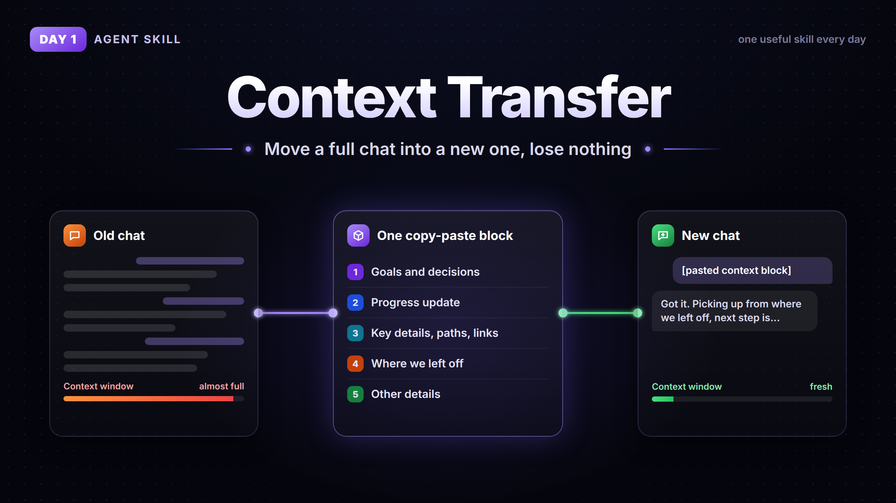

# Day 1: Context Transfer

Long chats get slow and start forgetting stuff. This skill packs the whole conversation into one copy-paste block so you can continue in a fresh chat without losing anything.

The block has 5 parts:

1. Goals and decisions
2. Progress update
3. Key details (files, links, names, numbers)
4. Where we left off
5. Other details

## How to use

Drop `SKILL.md` into a folder called `context-transfer` in your agent's skills folder (Claude, Hermes, Codex etc). Then at the end of a long chat say "context transfer", copy the block it gives you and paste it into a new chat.

No skills support? Just paste the contents of `SKILL.md` as your last message.

## Similar versions

- [The AI Impact: Context transfer](https://www.theaiimpact.co/skills/context-transfer), 8 sections, works in ChatGPT and Claude
- [Gord1y/countersign-skills: context-transfer](https://github.com/Gord1y/countersign-skills/tree/main/skills/context-transfer), built for Claude Code, also checks git state
