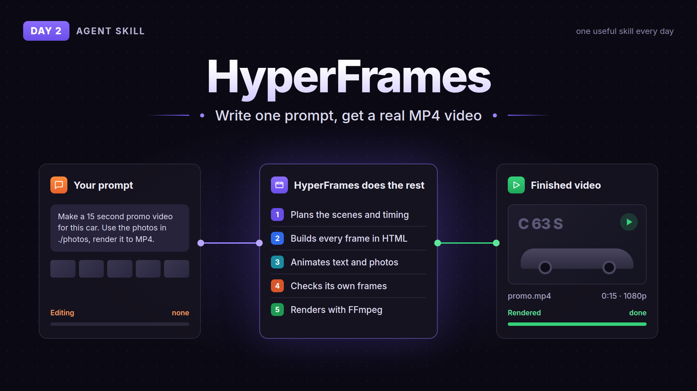

# Day 2: HyperFrames



HyperFrames is a skill pack from HeyGen that lets your agent make real videos. You write one prompt, it plans the scenes, builds every frame in HTML, animates text and photos, checks its own frames and renders an MP4 with FFmpeg. No video editor.

I tested it with a 15 second promo for a car using press photos. It worked, but the first try looked more like a slideshow with animations than a real promo, so tell it what you want for camera movement and cutting things out of the photos. For one prompt it's still pretty decent.

## How to use

Needs Node.js 22+ and FFmpeg.

```
npx skills add heygen-com/hyperframes
```

Then just ask your agent for a video, like "make a 15 second promo video for X, render it to MP4".

This one is not a single `SKILL.md`, it's a pack of skills with scripts and references, so install it from the original repo instead of copying files from here.

The skill pings HeyGen's telemetry when it starts. Turn it off with `npx hyperframes telemetry disable` or set `HYPERFRAMES_NO_TELEMETRY=1`.

## Credit

- [heygen-com/hyperframes](https://github.com/heygen-com/hyperframes), Apache-2.0
