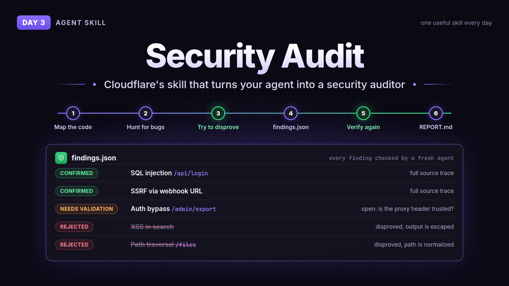

# Day 3: Security Audit



Security Audit is Cloudflare's open source skill that turns your coding agent into a security auditor. It's the skill their own vulnerability discovery system started from.

It runs in 6 phases. It maps the code, sends sub-agents out to hunt for bugs, and then gives every possible bug to a fresh agent whose job is to disprove it. What survives ends up in `findings.json` as confirmed, needs validation or rejected, and gets checked again before it writes the report. So you get fewer made up findings than when you just ask your agent "is this code secure".

## How to use

Needs Node.js and an agent that can run sub-agents in parallel (Claude Code, Codex etc).

The whole skill is in the `security-audit/` folder here. Copy that folder into your agent's skills folder (for Claude Code `~/.claude/skills/security-audit/`). `SKILL.md` is the main file, the other files are references and validator scripts it reads, so keep them together.

Or install it straight from Cloudflare:

```
npx skills add https://github.com/cloudflare/security-audit-skill --skill security-audit --global
```

Then open your agent in the repo and say "security audit this codebase". The report lands in `~/security-audit-skill/<repo-name>/` by default.

Run it more than once. Cloudflare says a single run found about half of what repeated runs found in total. It also uses a lot of tokens, since it spins up many agents.

## Credit

- [cloudflare/security-audit-skill](https://github.com/cloudflare/security-audit-skill), MIT. Copied as is, license included in `security-audit/LICENSE`
