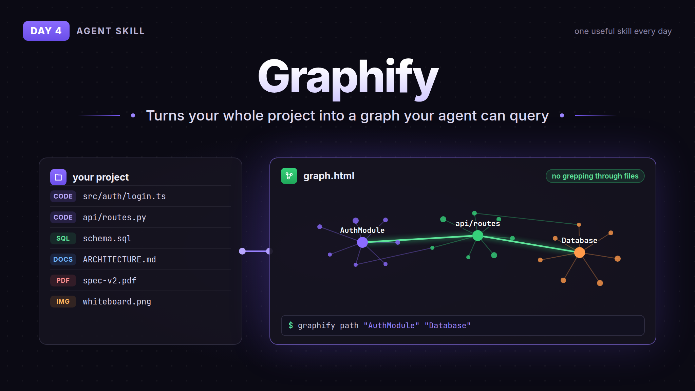

# Day 4: Graphify



Graphify turns your whole project into a knowledge graph your agent can query, instead of grepping through files every time. Code, docs, SQL schemas, PDFs, even images. Code is parsed locally with tree-sitter, so nothing leaves your machine for that part.

You get three files in `graphify-out/`: `graph.html` you can click around in, `GRAPH_REPORT.md` with the key concepts and connections, and `graph.json` the agent reads from later. Then you can ask stuff like `graphify path "AuthModule" "Database"` and it shows how two parts of the code connect.

## How to use

The skill drives the `graphify` CLI, so you need that installed too. Needs Python 3.10+ and uv (or pipx).

```
uv tool install graphifyy
```

Then copy the `graphify/` folder here into your agent's skills folder (for Claude Code `~/.claude/skills/graphify/`), keep `SKILL.md` and `references/` together. Or let the CLI register the skill for you:

```
graphify install
```

Open your agent in a project and type `/graphify .`

No telemetry, but it logs your queries to `~/.cache/graphify-queries.log`. Set `GRAPHIFY_QUERY_LOG_DISABLE=1` to turn that off.

## Credit

- [Graphify-Labs/graphify](https://github.com/Graphify-Labs/graphify), Apache-2.0 (older parts MIT). Skill files copied as is, licenses included in `graphify/`
