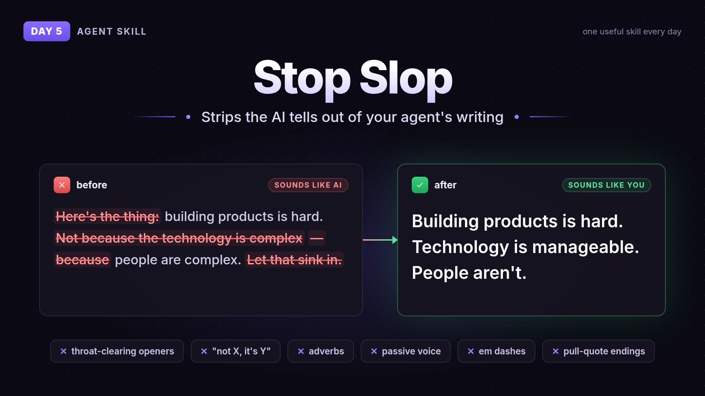

# Day 5: Stop Slop



Stop Slop strips the AI tells out of your agent's writing. Throat-clearing openers like "Here's the thing", "not X, it's Y" contrasts, adverbs, passive voice, em dashes, punchy pull-quote endings. Your agent checks its draft against the list before it hands it to you, and scores it on directness, rhythm, trust, authenticity and density. Under 35/50 it rewrites.

Good for anything you post or send under your own name: tweets, READMEs, docs, emails.

## How to use

Copy the `stop-slop/` folder here into your agent's skills folder (for Claude Code `~/.claude/skills/stop-slop/`), keep `SKILL.md` and `references/` together.

Then just ask it to write something, or say "run stop-slop on this" with a draft.

Or install from the source:

```
npx skills add hardikpandya/stop-slop
```

## Credit

- [hardikpandya/stop-slop](https://github.com/hardikpandya/stop-slop) by Hardik Pandya, MIT. Skill files copied as is, license included in `stop-slop/`
