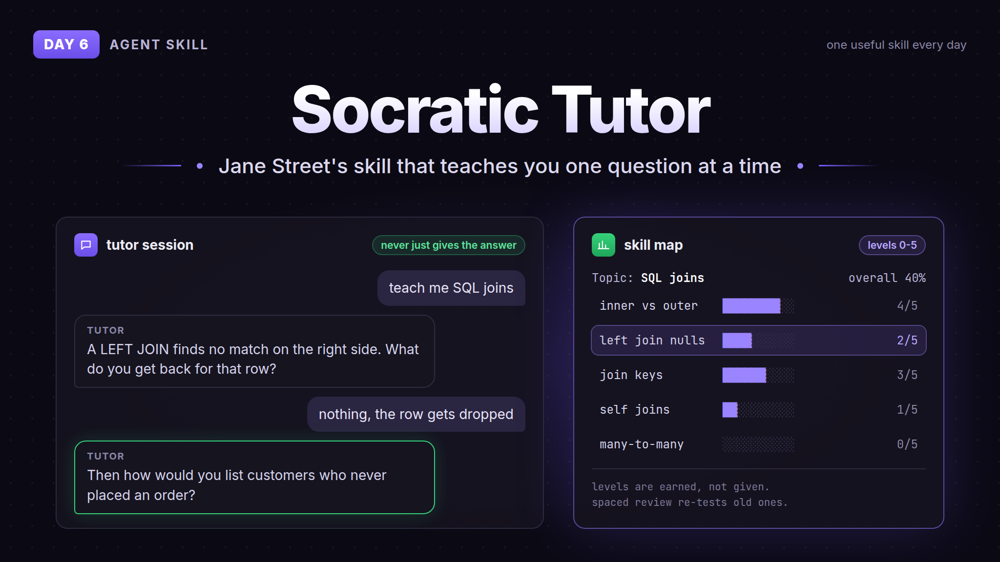

# Day 6: Socratic Tutor

A skill from Jane Street that turns your agent into a strict tutor. You say "teach me X", it asks a few questions to find your level, builds a skill map (every subskill rated 0 to 5) and then teaches you by asking, one question at a time. When you get something wrong it doesn't hand you the answer, it asks a narrower question until you see the problem yourself. It re-tests old stuff without warning, and the course only ends when every subskill is at 4/5 and you pass a final test.

Only starts when you actually ask to be taught ("teach me", "quiz me", "drill me"). A normal "what is X" gets a normal answer.

The SQL joins session on the banner is just an example of how it looks.

## How to use

Copy the `socratic-tutor/` folder into your agent's skills folder (for Claude Code `~/.claude/skills/socratic-tutor/`). Then say "teach me <topic>".

Works in a plain chatbot too: paste the body of `SKILL.md` into the chat or the custom instructions, then say what you want to learn.

Things you can say during a session: `show progress`, `harder`, `easier`, `just tell me` (one answer without the questioning), `save state` and `resume from:` to continue in a new chat.

## Credit

- [janestreet/agent_skills](https://github.com/janestreet/agent_skills) by Jane Street, MIT. Skill file copied as is, license included in `socratic-tutor/`
