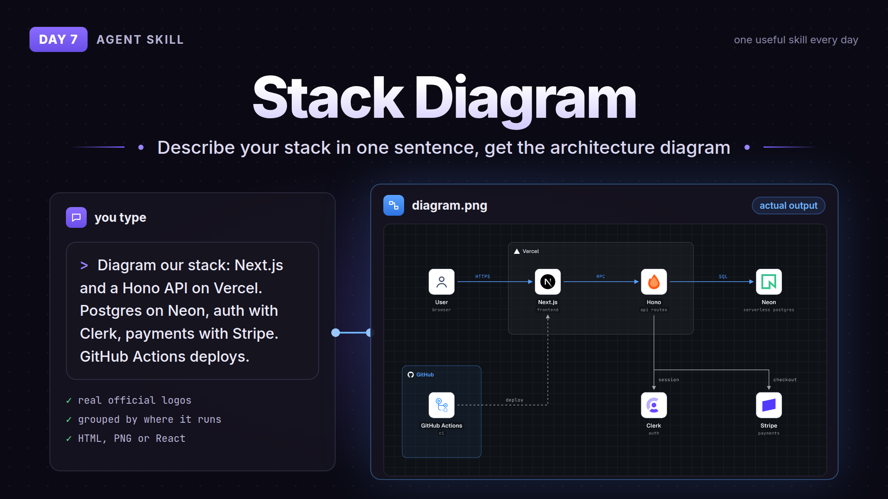

# Day 7: Stack Diagram



Describe your stack in one sentence and your agent draws the architecture diagram. Real official logos (Next.js, Neon, Stripe, AWS, GCP, Azure, Kubernetes...), boxes for what runs where, arrows for how the parts talk to each other. You get one self-contained HTML file, and from that a PNG in light and dark, or a React component.

The diagram on the banner is the real output from the author's README for this prompt:

> Diagram our stack: Next.js and a Hono API on Vercel. Postgres on Neon, auth with Clerk, payments with Stripe. GitHub Actions deploys.

## How to use

Needs Python 3.9+ and internet to fetch the logos. For PNG output also Playwright with Chromium:

```
pip install playwright && python3 -m playwright install --with-deps chromium
```

Copy the `stack-diagram/` folder into your agent's skills folder (for Claude Code `~/.claude/skills/stack-diagram/`), keep `scripts/`, `assets/` and `references/` together. Or install from the source:

```
npx skills add caru-ini/stack-diagram
```

Then ask "diagram our stack: ..." in plain words.

After it's done the agent may offer to post your diagram to a public gallery. It only does that if you say yes, and it asks you to check for internal names first. Just say no if it's a work system.

## Credit

- [caru-ini/stack-diagram](https://github.com/caru-ini/stack-diagram) by caru-ini, MIT. Bundled fonts are SIL OFL 1.1. Skill files copied as is, licenses included in `stack-diagram/`
