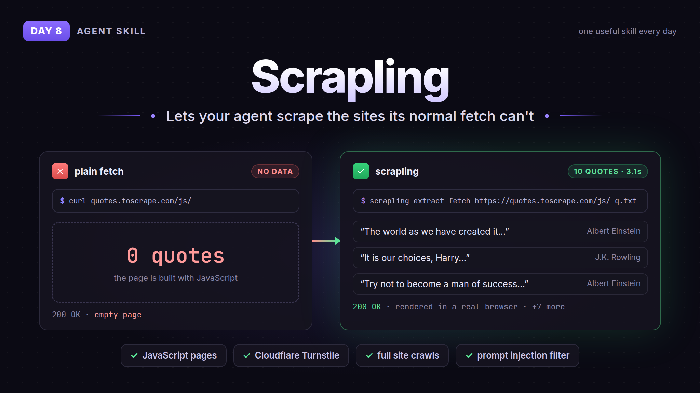

# Day 8: Scrapling



The official agent skill for [Scrapling](https://github.com/D4Vinci/Scrapling), the Python scraping library. It teaches your agent to get pages its normal fetch can't: pages built with JavaScript, sites behind Cloudflare Turnstile, full site crawls with spiders, and pulling out exactly what you need with CSS selectors. It always runs with `--ai-targeted`, which strips hidden elements from the page so a site can't sneak instructions into your agent.

The banner is a real run. `curl` on quotes.toscrape.com/js/ gives back a page with 0 quotes because it's built with JavaScript. `scrapling extract fetch https://quotes.toscrape.com/js/ q.txt` got all 10 in about 3 seconds.

## How to use

Needs Python 3.10+:

```
pip install "scrapling[all]>=0.5.1"
scrapling install
```

`scrapling install` downloads the browser and installs its system packages, which can ask for sudo. If that step fails but you already have Playwright's Chromium installed, fetching still works. Note: the URL needs `https://` in front.

Copy the `scrapling/` folder into your agent's skills folder (for Claude Code `~/.claude/skills/scrapling/`), keep `references/` and `examples/` together. Or install from the source:

```
npx skills add D4Vinci/Scrapling --skill scrapling-official
```

Then just ask your agent to scrape or crawl something.

Only scrape what you're allowed to. The skill itself tells the agent to respect robots.txt and terms of service, and not to get around paywalls or logins.

## Credit

- [D4Vinci/Scrapling](https://github.com/D4Vinci/Scrapling) by Karim Shoair, BSD-3-Clause. Skill files copied as is, license included in `scrapling/LICENSE.txt`
