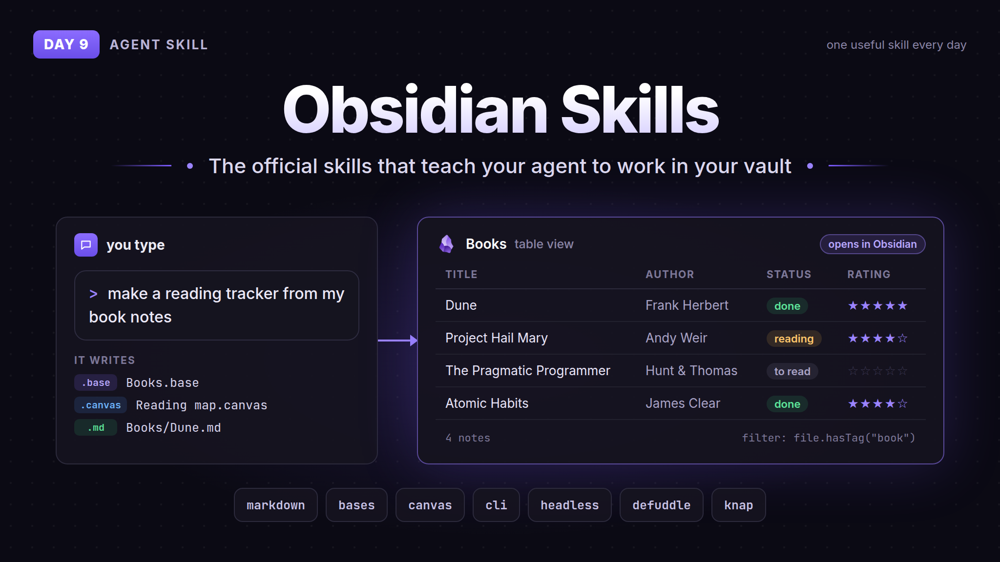

# Day 9: Obsidian Skills



The official agent skills from Obsidian, made by Steph Ango (kepano). Without them your agent writes plain markdown and guesses at the rest, so wikilinks, callouts, properties, `.base` and `.canvas` files often come out broken. With them it knows the real formats.

7 skills in the pack:

- `obsidian-markdown`: wikilinks, embeds, callouts, properties
- `obsidian-bases`: `.base` files with table, cards, list, map and kanban views, filters and formulas
- `json-canvas`: `.canvas` files, mind maps, flowcharts
- `obsidian-cli`: read, search and edit your vault through the Obsidian CLI, plus plugin and theme dev
- `obsidian-headless`: Sync and Publish from a terminal or server, no desktop app
- `defuddle`: turn a web page into clean markdown
- `knap`: generate notes from templates and JSON or CSV

The reading tracker on the banner is just an example of what it can make.

## How to use

Copy the folders inside `obsidian-skills/` into `.claude/skills/` in your vault (or `~/.claude/skills/` to have them everywhere). For Codex use `~/.agents/skills`.

Or install from the source:

```
claude plugin marketplace add obsidianmd/obsidian-skills
claude plugin install obsidian@obsidian-skills
```

or `npx skills add https://github.com/obsidianmd/obsidian-skills`

## Credit

- [obsidianmd/obsidian-skills](https://github.com/obsidianmd/obsidian-skills) by Steph Ango (@kepano), MIT. Skill files copied as is, license included in `obsidian-skills/`
