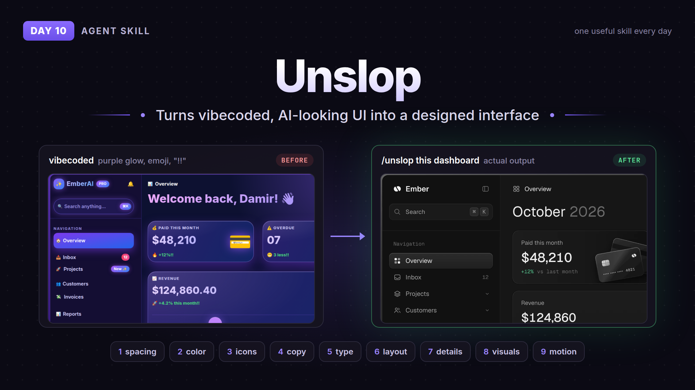

# Day 10: Unslop



A skill by Damir Sokolovsky ([@heydamir](https://x.com/heydamir)) that turns vibecoded, AI-looking UI into a designed interface. It first lists every sign of slop it finds (purple gradients, glows, emoji labels, shouty copy, uneven spacing), proposes a direction based on your product, and only then edits, pass by pass: spacing, color, icons, copy, type, layout, details, visuals, motion. Works on React, Vue, Svelte, Tailwind, plain HTML and CSS, or a live site from just a link. If the screen is already good it says so instead of redesigning it.

On the banner: the left side is the author's vibecoded example (`examples/dashboard.html` in the source repo) and the right side is the author's own finished version of it, both straight from the repo.

## How to use

Copy the `unslop/` folder into `~/.claude/skills/` (or `.claude/skills/` in one project). For Codex use `~/.agents/skills/`. Then:

```
/unslop this dashboard
/unslop the hero of https://example.com
```

Or install it as a Claude Code plugin from the source:

```
claude plugin install unslop --marketplace heydamir/unslop
```

Snapshotting a live site and the story video (a short clip of your screen unslopping itself) need Playwright and Chromium (`npm install -D playwright && npx playwright install chromium`), and the video also needs ffmpeg. For hero images it can use a paid image service like fal or Replicate, but it shows the prompt and asks before every paid generation.

## Credit

- [heydamir/unslop](https://github.com/heydamir/unslop) by Damir Sokolovsky, CC BY 4.0. Skill files copied as is, license included in `unslop/LICENSE`
