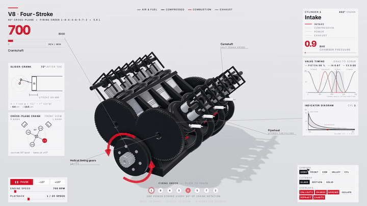

# Day 11: Teardown



A Claude Code skill by [elvarofficial](https://github.com/elvarofficial) that turns any machine into a 3D simulator you can take apart. Ask how something works and your agent builds it as one offline HTML page: the machine runs in the middle, the panels around it read the real numbers from the same model that moves the parts, a button opens the part doing the work, and when nobody touches it the page tours itself. It can also record the tour frame by frame to a 60 fps video with its own sound.

The GIF above is a real render: the skill's own V8 example, built with `sims/build.mjs` and recorded with `sims/capture.mjs` (cut from the full 26 second tour).

## How to use

Needs Node.js 20+. For video also `ffmpeg`, and for sound Python 3.

Copy the `teardown/` folder into `~/.claude/skills/`, then once inside it:

```
npm install && npx playwright install chromium
```

Or install from the source: `npx skills add elvarofficial/teardown -g -a claude-code`

Then ask in plain words:

> Build me a simulator of a 4-stroke motorcycle engine I can take apart.

> Make a teardown of a hydraulic excavator arm and record a 20-second video of it.

Recording runs a 3D page frame by frame in headless Chromium, so it wants a real GPU. On a machine with only software rendering it is around 30x slower. On Linux your user has to be in the `render` group, and `--use-angle=gl-egl` (or `vulkan`) gets Chromium onto the GPU; the recorder prints which GPU it got.

## Credit

- [elvarofficial/teardown](https://github.com/elvarofficial/teardown), MIT. Skill files copied as is, license in `teardown/LICENSE`
- Built on [whaleyxbt/claude-motion](https://github.com/whaleyxbt/claude-motion) (MIT). Sound samples CC0 from Freesound, sources in `teardown/sfx/samples/SOURCES.md`
