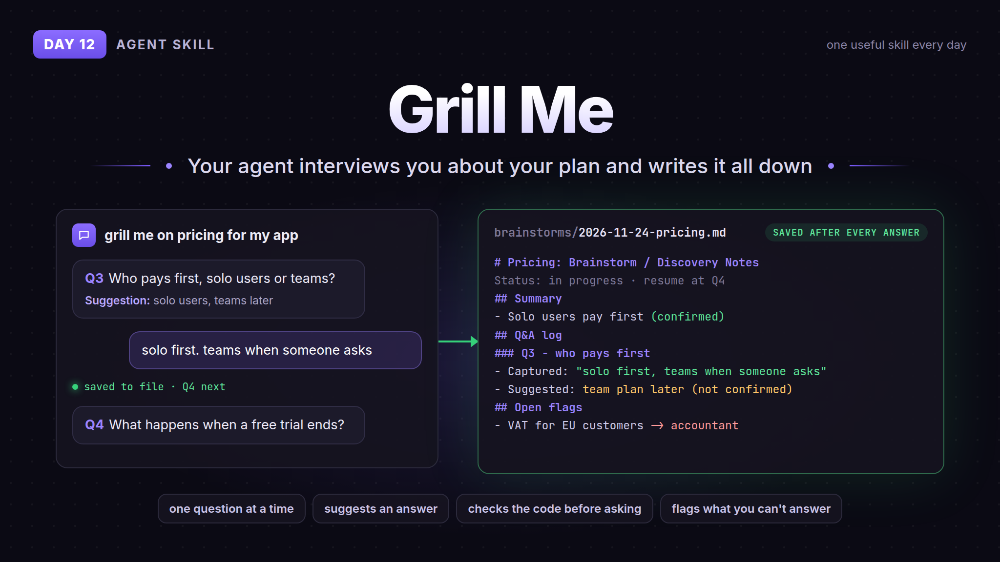

# Day 12: Grill Me



A skill that makes your agent interview you about a plan, a design or an idea, one question at a time, until it understands the whole thing. For decisions it suggests an answer you can accept or reject, if the code or a doc already has the answer it reads that instead of asking, and when you don't know something it writes it down as an open flag with who should answer it and moves on.

What makes this version useful: after every single answer it saves to a markdown file in `brainstorms/` before asking the next question. So when the conversation gets long and the agent starts forgetting, nothing is lost. The file keeps what you actually confirmed apart from the agent's own suggestions and the open questions, and at the end you have a clean doc of your plan you can hand to anything else.

The pricing interview on the banner is just an example.

## How to use

Copy the `grill-me/` folder into `~/.claude/skills/` (or `.claude/skills/` in one project). For Codex use `~/.agents/skills/`. Then:

```
grill me on <your plan>
```

It only runs when you ask for it. The capture files go to `brainstorms/` in the folder you run it from.

The skill comes from Nate Herk's AI OS starter kit, so near the end it may mention `/link` or `/level-up`. Those are other skills in that kit, it never runs them on its own and you can ignore them.

## Credit

- [nateherkai/AIS-OS](https://github.com/nateherkai/AIS-OS/tree/main/.claude/skills/grill-me) by Nate Herk, MIT. Skill files copied as is, license in `grill-me/LICENSE`
- The original grill-me idea is by Matt Pocock: [mattpocock/skills](https://github.com/mattpocock/skills) (MIT). Nate's version adds the file that saves every answer
